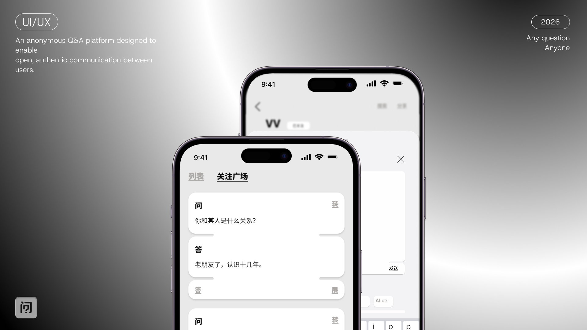

# 四件 | 设计作品集与交互演示

大连理工大学工业设计在读，预计 2027 年毕业。关注 UI/UX、产品体验与 AI 辅助设计开发。

本仓库是个人作品集的静态发布版本，集中展示「我的匿名提问箱」的产品规则、界面设计与可交互前端演示。

**[打开七页作品集与交互 Demo](https://sijian0202.github.io/home/) · [阅读设计案例](./CASE_STUDY.md)**



## 项目概述

「我的匿名提问箱」围绕低压力表达与真诚回应展开：用户可以匿名提问、邀请关注的人回答，并在公开路径中浏览与参与问答。

设计围绕三个问题展开：

1. 如何让用户理解匿名身份、回答归属与私密内容之间的区别？
2. 如何区分邀请回答、公开参与与查看回应等不同任务？
3. 如何通过卡片层级与界面状态，让一个问题下的多方回答保持可读？

## 我的职责与协作

- 开展需求调研，梳理用户画像、使用习惯与审美需求。
- 设计 UI、交互逻辑与 Figma 高保真原型，推敲内容层级、账号归属和私密边界。
- 借助 Codex、Claude 进行 AI 辅助前端开发与交叉检查，调整动效、状态反馈与交互逻辑。
- 使用前端 Mock 数据层组织用户、问答、回复与关注关系，使数据与界面逻辑分离。
- 参与上线推进及界面与交互维护；正式 App 由团队协作完成。

AI 在本项目中主要用于辅助开发与检查。该经历用于展示设计落地实践，不将其表述为已实现 AI Agent 或智能问答功能。

## 关键设计决策

| 设计问题 | 当前方案 | 可以观察的内容 |
| --- | --- | --- |
| 匿名是否意味着内容私密？ | 将身份展示和内容可见范围分别定义 | 提问者身份、回答账号归属、公开与私密路径 |
| 邀请和公开参与如何共存？ | 邀请进入受邀者的「收到」，公开问题允许其他用户参与 | 邀请入口、收到列表与公开问答路径 |
| 多人回答如何保持层级？ | 问题、当前账号回答、他人回答与回复使用不同卡片层次 | 本人未回答及已回答时的状态差异 |
| 如何减少任务混淆？ | 用「收到」「发出」等入口区分回应邀请和追踪自己的提问 | 导航、列表及问题详情之间的关系 |

这些是设计意图与当前演示规则；尚不作为经过用户测试证明的效果结论。

## 如何体验

1. 打开 [七页作品集](https://sijian0202.github.io/home/)，从封面进入第 2 页体验交互 Demo；可通过右侧翻页导航查看全部七页。
2. 观察「收到」「发出」等路径中的问答与回答状态。
3. 在作品集页面查看使用流程、高保真模型与卡片结构。
4. 结合 [设计案例](./CASE_STUDY.md) 阅读设计取舍与后续验证计划。

**版本说明**：在线 Demo 默认以 VV 账号进入，使用浏览器内的 Mock 数据；刷新恢复初始内容，不连接正式后端，也不与真实用户或其他设备同步。本仓库是展示发布副本，不是正式 App 的完整源码仓库。正式 App 的功能与限制以商店当前版本为准。

## 本地运行

无需安装前端依赖或构建。安装 Python 3 后，在仓库根目录运行：

```sh
python -m http.server 8000
```

浏览器打开 `http://localhost:8000/`，直接演示入口为 `http://localhost:8000/demo.html`。使用本地 HTTP 服务，确保模块脚本能正常加载。

## 目录说明

```text
index.html          作品集入口
demo.html           可交互演示入口
portfolio/          作品展示图片与视觉资源
assets/             已构建的前端脚本与样式
project-notes.js     演示说明与产品规则
portfolio-pages.js   作品集翻页与动效
CASE_STUDY.md       设计问题、方案与验证计划
DEPLOYMENT.md       静态部署说明
```

## 后续验证

- 检查首次使用者能否理解匿名与私密的区别。
- 观察从收到邀请到完成回答的路径是否清晰。
- 检查中文文字按钮的识别、误触与返回成本。
- 记录问题、修改方案及复测结果，再补充可以追溯的验证结论。

目前不公布未经整理核实的用户规模、留存、转化或效率提升数据。
